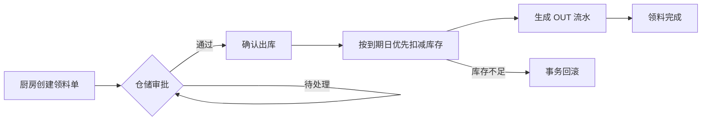
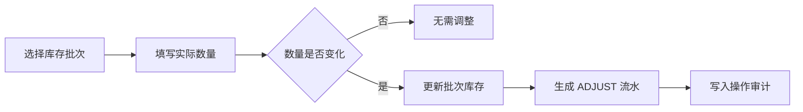
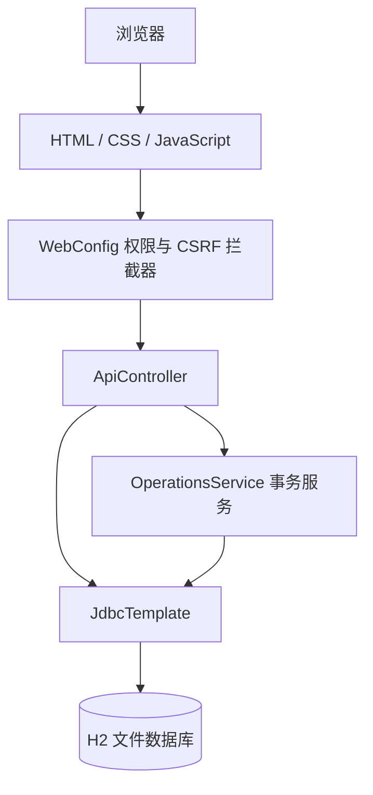

# 餐饮企业食材管理系统

一个面向餐饮企业中央仓、门店厨房和采购人员的食材库存管理平台。系统覆盖食材主数据、批次库存、采购入库、门店领料、审批出库、库存盘点、账户权限和操作审计。

项目采用 Spring Boot 3 + H2 + 原生 HTML/CSS/JavaScript 构建，部署简单，适合作为课程设计、毕业设计、内部原型或二次开发基础。

## 项目信息

| 项目 | 内容 |
| --- | --- |
| 当前版本 | `v1.0.0` |
| 后端 | Java 17、Spring Boot 3.5.7、Spring JDBC |
| 数据库 | H2 2.3.232，文件模式 |
| 前端 | 原生 HTML、CSS、JavaScript |
| 认证 | HttpSession、BCrypt、CSRF Token |
| 构建工具 | Maven 3.9+ |
| 测试 | JUnit 5、Spring Boot Test、MockMvc |
| 运行端口 | 默认 `8080` |

## 更新日志

版本功能、数据库变更、修复记录和验证结果见 [CHANGELOG.md](CHANGELOG.md)。

## 功能概览

### 运营概览

- 库存总值、食材品类、临期预警、低库存预警
- 按分类汇总库存水位
- 临期批次和过期批次提醒
- 最近库存流水
- 最近领料动态

### 食材档案

- 食材名称、分类、规格和计量单位
- 参考单价、保质期、安全库存和目标库存
- 新增和编辑食材
- 按名称、分类、规格或单位搜索

### 库存台账

- 按批次记录库存数量、单位成本和到期日期
- 按食材名称、批次号搜索
- 按仓库筛选
- 临期、过期和正常状态提示
- 单批次库存盘点
- 盘点差异自动生成 `ADJUST` 库存流水
- 导出 CSV 库存台账

### 门店领料

- 厨房创建多明细领料申请
- 仓储或管理员审批领料单
- 确认出库时按到期日优先扣减库存
- 自动生成 `OUT` 库存流水
- 库存不足时整笔事务回滚
- 领料单明细弹窗

### 采购管理

- 创建采购订单和采购明细
- 记录供应商、到货仓库、数量和单价
- 自动计算采购总额
- 待入库订单确认
- 采购入库自动创建库存批次
- 自动生成 `IN` 库存流水

### 供应商管理

- 供应商名称、联系人、电话和地址
- 供应商搜索
- 新增供应商

### 账户与密码

- 所有用户可修改自己的密码
- 修改密码需要验证当前密码
- 新密码至少 8 个字符
- 管理员可创建新账户
- 管理员可分配管理员、仓储采购员或门店厨师角色
- 厨房账号必须绑定门店

### 操作审计

- 记录关键业务操作和账户操作
- 记录操作人、动作、详情和时间
- 管理员可在统计报表页面查看最近操作记录

## 角色与权限

| 角色 | 账号示例 | 主要权限 |
| --- | --- | --- |
| 系统管理员 `ADMIN` | `admin` | 全部数据、采购、库存、报表、领料、账户和审计 |
| 仓储采购员 `WAREHOUSE` | `warehouse` | 库存、采购、供应商、领料审批、报表 |
| 门店厨师 `KITCHEN` | `kitchen` | 本门店数据、创建领料单、查看本店领料 |

权限码存储在 `app_role.permissions` 中：

- `system`：账户管理和系统级功能
- `base`：基础访问
- `purchase`：采购和供应商
- `stock`：库存、食材、盘点和领料审批
- `report`：统计报表和库存导出
- `kitchen`：门店领料

## 业务流程

### 领料流程



### 采购流程


### 盘点流程



## 技术架构



### 代码职责

- `ApiController`：REST 接口、权限判断、数据查询和统一返回结构
- `OperationsService`：领料、采购、库存、食材、账户和密码等事务逻辑
- `WebConfig`：登录校验、账号状态校验、CSRF 校验和权限属性注入
- `ApiExceptionHandler`：API 错误信息统一处理
- `SeedData`：首次启动时初始化演示数据
- `app.js`：页面渲染、表单交互和 API 调用
- `app.css`：桌面端和移动端响应式视觉系统

## 项目结构

```text
shi/
├── README.md
├── .gitignore
└── 餐饮管理系统/
    ├── application.yml
    ├── pom.xml
    ├── start.cmd
    ├── data/
    │   └── catering.mv.db
    ├── src/main/java/cn/catering/
    │   ├── Application.java
    │   ├── ApiController.java
    │   ├── ApiExceptionHandler.java
    │   ├── OperationsService.java
    │   ├── SeedData.java
    │   └── WebConfig.java
    ├── src/main/resources/
    │   ├── schema.sql
    │   └── static/
    │       ├── index.html
    │       ├── app.css
    │       └── app.js
    └── src/test/java/cn/catering/
        └── ApiIntegrationTest.java
```

## 快速开始

### 环境要求

- JDK 17 或更高版本
- Maven 3.9 或更高版本
- Windows 可使用项目内的 `start.cmd`

### 方式一：Windows 双击启动

1. 进入 `餐饮管理系统` 目录。
2. 双击 `start.cmd`。
3. 等待数秒，浏览器自动打开 `http://localhost:8080`。

如果 `8080` 端口已经有本系统运行，脚本会直接打开浏览器。

### 方式二：Maven 启动

```bash
git clone https://github.com/98jm7s7wym-alt/shi.git
cd shi/餐饮管理系统

mvn spring-boot:run
```

### 方式三：构建 JAR

```bash
cd shi/餐饮管理系统
mvn clean package
java -jar target/food-material-system-1.0.0.jar
```

浏览器访问：

```text
http://localhost:8080
```

## 演示账号

| 角色 | 用户名 | 初始密码 |
| --- | --- | --- |
| 系统管理员 | `admin` | `Demo@123456` |
| 仓储采购员 | `warehouse` | `Demo@123456` |
| 门店厨师 | `kitchen` | `Demo@123456` |

登录页提供三个演示账号的快速填充按钮。

> 演示密码只用于首次初始化演示数据。真实部署前必须修改默认密码。

## 配置说明

配置文件：`餐饮管理系统/application.yml`

```yaml
server:
  port: ${PORT:8080}

spring:
  datasource:
    url: jdbc:h2:file:./data/catering;MODE=MySQL;DATABASE_TO_LOWER=TRUE;DB_CLOSE_ON_EXIT=FALSE
    username: sa
    password: ${DB_PASSWORD:}
  sql.init.mode: always

app.demo-password: ${DEMO_PASSWORD:Demo@123456}
```

支持的环境变量：

| 环境变量 | 作用 | 默认值 |
| --- | --- | --- |
| `PORT` | HTTP 端口 | `8080` |
| `DB_PASSWORD` | H2 数据库密码 | 空 |
| `DEMO_PASSWORD` | 首次初始化账号密码 | `Demo@123456` |

`DEMO_PASSWORD` 只在数据库中没有用户时生效。已有数据库不会自动重置密码。

## 数据库设计

主要表：

| 表名 | 说明 |
| --- | --- |
| `app_role` | 角色和权限码 |
| `app_user` | 系统账号 |
| `store` | 门店 |
| `warehouse` | 仓库 |
| `category` | 食材分类 |
| `ingredient` | 食材主数据 |
| `supplier` | 供应商 |
| `stock_batch` | 库存批次 |
| `movement` | 入库、出库和盘点流水 |
| `requisition` | 领料单 |
| `requisition_line` | 领料明细 |
| `purchase_order` | 采购单 |
| `purchase_line` | 采购明细 |
| `audit_log` | 操作审计 |

库存变化统一写入 `movement`：

- `IN`：采购入库
- `OUT`：领料出库
- `ADJUST`：库存盘点调整

## API 接口

### 认证与数据

| 方法 | 路径 | 说明 |
| --- | --- | --- |
| `POST` | `/api/login` | 登录 |
| `GET` | `/api/me` | 当前登录用户 |
| `POST` | `/api/logout` | 退出登录 |
| `GET` | `/api/data` | 获取当前角色可见的业务数据 |
| `GET` | `/api/export/inventory` | 导出库存 CSV |

### 业务操作

统一入口：

```text
POST /api/action/{action}
```

支持的 `action`：

| Action | 权限 | 说明 |
| --- | --- | --- |
| `create-requisition` | `kitchen` | 创建领料单 |
| `approve-requisition` | `stock` | 审批领料单 |
| `complete-requisition` | `stock` | 确认出库并扣减库存 |
| `create-purchase` | `purchase` | 创建采购单 |
| `receive-purchase` | `purchase` | 采购入库 |
| `create-supplier` | `purchase` | 新增供应商 |
| `save-ingredient` | `stock` | 新增或编辑食材 |
| `adjust-stock` | `stock` | 库存盘点 |
| `update-profile` | 登录用户 | 修改显示名称 |
| `change-password` | 登录用户 | 修改自己的密码 |
| `create-user` | `system` | 创建账户 |

写操作必须携带登录会话生成的 CSRF Token：

```http
X-CSRF-Token: <token>
```

## 安全设计

- 密码使用 BCrypt 哈希保存
- 登录后更换 Session ID，降低会话固定风险
- 所有 `/api/**` 接口默认要求登录
- 每次请求重新校验账号是否启用
- 写操作校验 CSRF Token
- API 根据角色权限码执行授权
- 厨房账号只能查看和操作所属门店数据
- 领料出库、采购入库和库存盘点使用事务
- 所有关键写操作写入 `audit_log`

## 测试

运行全部测试：

```bash
cd shi/餐饮管理系统
mvn test
```

当前 8 个集成测试覆盖以下场景：

1. 未登录请求拦截和厨房数据范围
2. 厨房越权审批
3. 领料出库扣库和流水
4. 库存不足事务回滚
5. 采购入库增加库存
6. 创建账户和越权拦截
7. 修改密码和旧密码失效
8. 食材新增、编辑和库存盘点

测试使用独立 H2 内存数据库，不会修改本地业务数据库。

## 发布与下载

- GitHub 仓库：<https://github.com/98jm7s7wym-alt/shi>
- GitHub Release：<https://github.com/98jm7s7wym-alt/shi/releases/tag/v1.0.0>
- 可运行压缩包：<https://github.com/98jm7s7wym-alt/shi/releases/download/v1.0.0/food-material-system-1.0.0.zip>

压缩包内容：

```text
food-material-system/
├── README.md
├── start.cmd
└── target/
    └── food-material-system-1.0.0.jar
```

## 服务器部署示例

```bash
mkdir -p /opt/food-material-system/data
cp food-material-system-1.0.0.jar /opt/food-material-system/app.jar
cd /opt/food-material-system

PORT=8080 \
DEMO_PASSWORD='请替换为强密码' \
nohup java -jar app.jar > app.log 2>&1 &
```

建议生产环境补充：

- Nginx 或其他反向代理
- HTTPS
- 独立数据库账号和强密码
- 数据库定时备份
- JVM 内存和日志轮转配置
- 登录失败限流
- 账号停用和管理员重置密码

## 已知限制

- 当前使用 H2 文件数据库，适合单机和小规模部署
- 暂无采购退货和领料驳回流程
- 暂不支持账号停用和管理员重置密码
- 暂未提供采购单、领料单的 Excel 导出
- 当前没有生产级数据库迁移工具
- 浏览器端自动化测试仍需补充

## 后续计划

- [ ] 采购退货和领料驳回
- [ ] 批量盘点
- [ ] 账号停用和管理员重置密码
- [ ] 采购单、领料单 Excel 导出
- [ ] Flyway 数据库迁移
- [ ] Docker Compose 部署
- [ ] Playwright 浏览器端测试
- [ ] MySQL 和 PostgreSQL 生产配置

## 贡献

欢迎提交 Issue 或 Pull Request。提交前建议：

1. 运行 `mvn test`
2. 检查桌面端和移动端页面
3. 不提交 `data/` 下的运行时数据库
4. 不提交密码、Token 或其他敏感配置

## 许可证

本项目仅供学习交流使用。使用、分发或二次开发前，请确认项目所有者授权。
